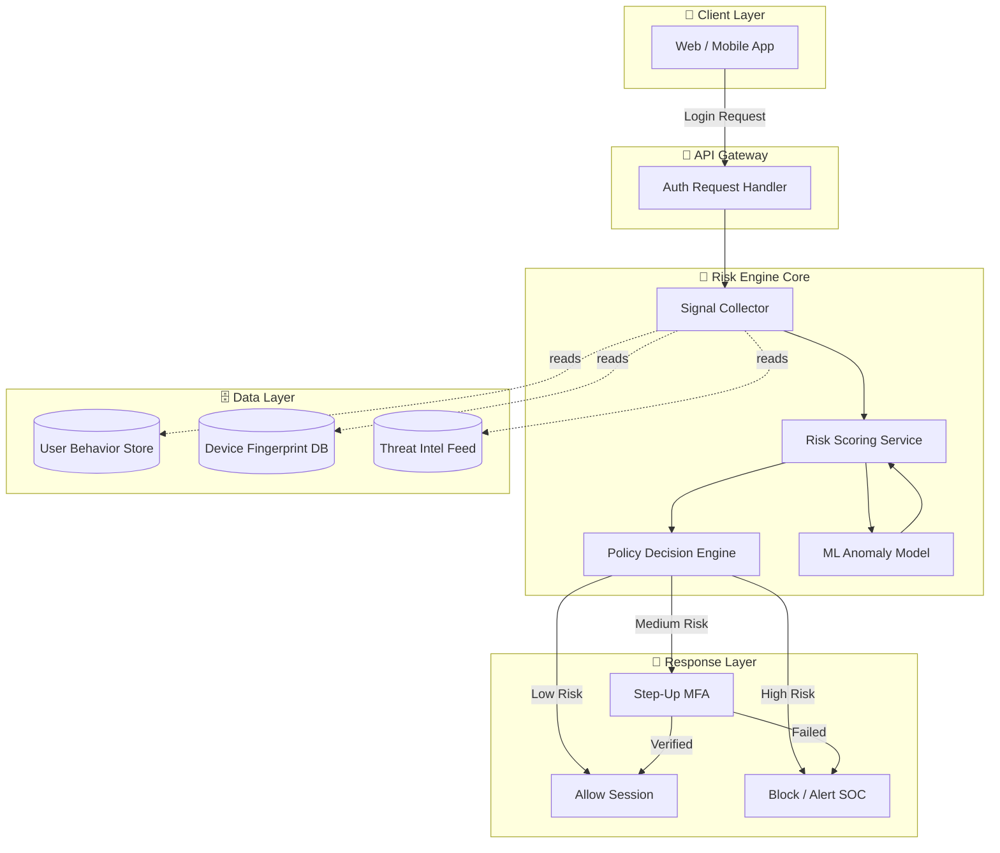
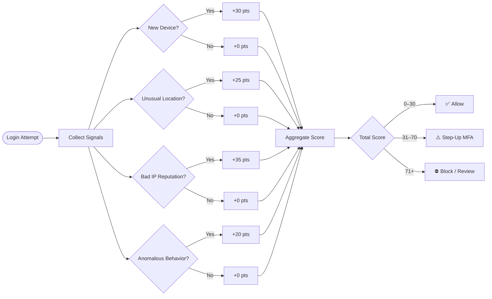
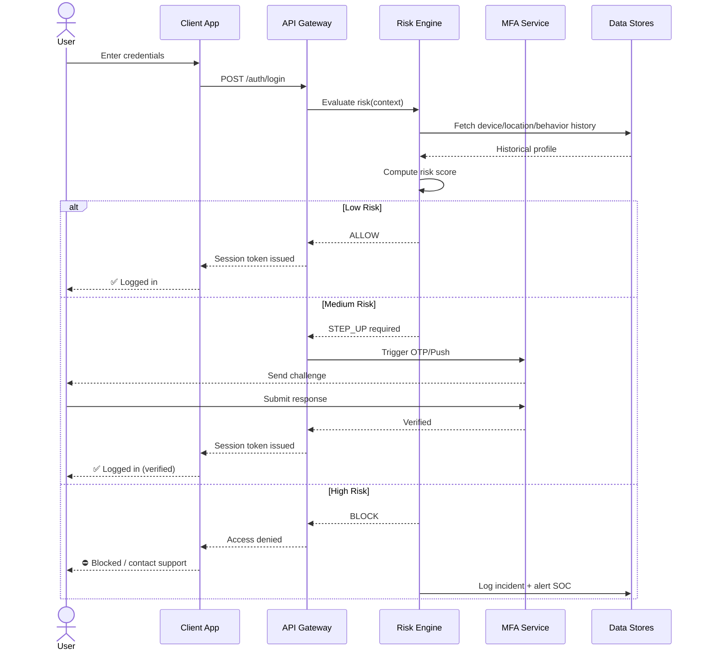
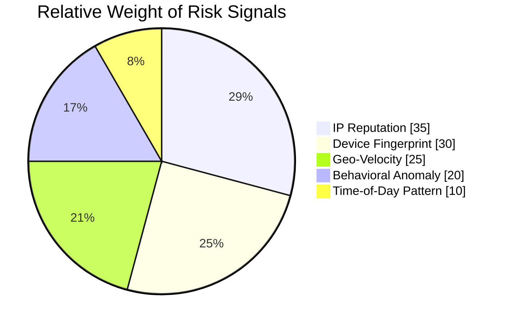
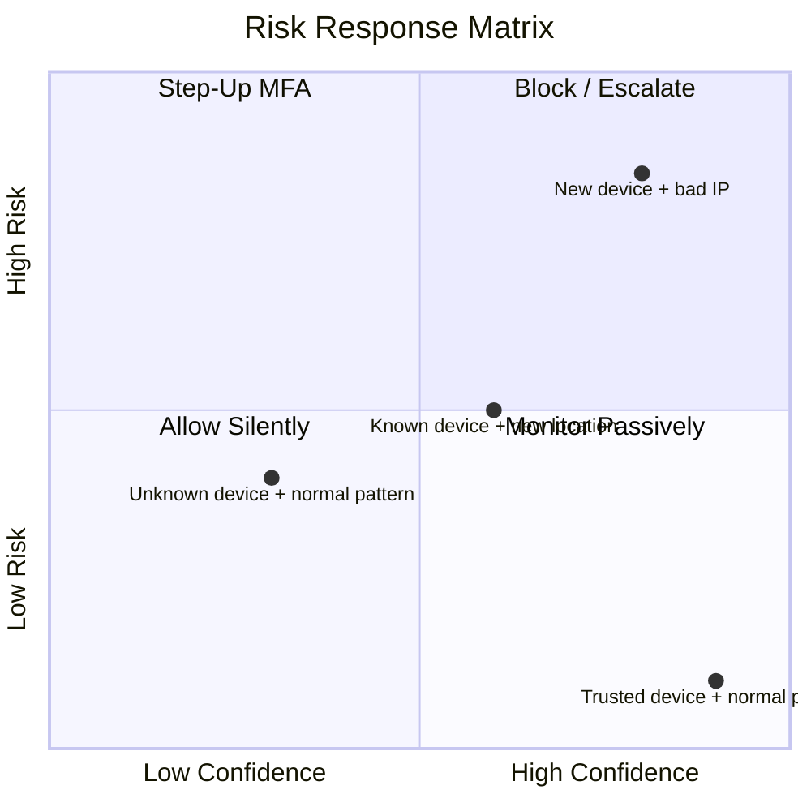

# risk-based-authentication-systeem
# 🛡️ Risk-Based Authentication (RBA) System

[](LICENSE)
[](#)
[](#)
[](#contributing)

An adaptive authentication engine that evaluates **contextual risk signals** in real time — device, location, behavior, and network reputation — and dynamically adjusts authentication requirements (allow, step-up MFA, or block) instead of relying on static passwords alone.

---

## 📑 Table of Contents

- [Overview](#-overview)
- [Key Features](#-key-features)
- [System Architecture](#-system-architecture)
- [Risk Scoring Flow](#-risk-scoring-flow)
- [Authentication Sequence](#-authentication-sequence)
- [Risk Signal Breakdown](#-risk-signal-breakdown)
- [Decision Matrix](#-decision-matrix)
- [Tech Stack](#-tech-stack)
- [Getting Started](#-getting-started)
- [Configuration](#-configuration)
- [API Reference](#-api-reference)
- [Roadmap](#-roadmap)
- [Contributing](#-contributing)
- [License](#-license)

---

## 🔍 Overview

Traditional authentication treats every login attempt the same way. **Risk-Based Authentication (RBA)** instead computes a real-time risk score per session using multiple signals, then chooses a proportionate response:

- ✅ **Low risk** → seamless login, no friction
- ⚠️ **Medium risk** → step-up challenge (OTP, push notification, biometric)
- ⛔ **High risk** → block, alert, or require manual review

This reduces friction for legitimate users while raising the bar for attackers, credential-stuffing bots, and account takeover attempts.

---

## ✨ Key Features

| Feature | Description |
|---|---|
| 🌍 Geo-velocity checks | Detects impossible travel between logins |
| 📱 Device fingerprinting | Flags new/unrecognized devices |
| 🕵️ Behavioral biometrics | Typing cadence, mouse movement, session patterns |
| 🌐 IP reputation | Cross-checks against threat intel & VPN/Tor lists |
| 🔐 Adaptive MFA | Step-up authentication triggered only when needed |
| 📊 Real-time risk scoring | Weighted scoring engine, sub-100ms decisioning |
| 🧠 ML-based anomaly detection | Learns per-user baseline behavior over time |
| 📈 Audit dashboard | Full visibility into risk decisions and overrides |

---

## 🏗 System Architecture



---

## 📊 Risk Scoring Flow



---

## 🔄 Authentication Sequence



---

## 🧩 Risk Signal Breakdown



---

## 🧮 Decision Matrix



---

## 🛠 Tech Stack

- **Backend:** Node.js / Python (FastAPI)
- **Risk Engine:** Custom scoring service + ML model (scikit-learn / TensorFlow)
- **Cache/Session:** Redis
- **Database:** PostgreSQL (user & audit data), MongoDB (behavioral logs)
- **Messaging:** Kafka (event streaming for real-time signals)
- **MFA Providers:** Twilio / Firebase / WebAuthn
- **Threat Intel:** IPQualityScore / AbuseIPDB integration
- **Infra:** Docker, Kubernetes

---

## 🚀 Getting Started

### Prerequisites
- Node.js ≥ 18 or Python ≥ 3.10
- Docker & Docker Compose
- Redis & PostgreSQL instances

### Installation

```bash
git clone https://github.com/your-org/risk-based-auth.git
cd risk-based-auth
cp .env.example .env
docker-compose up -d
npm install        # or: pip install -r requirements.txt
npm run migrate
npm run dev
```

### Quick Test

```bash
curl -X POST http://localhost:3000/auth/login \
  -H "Content-Type: application/json" \
  -d '{"username":"demo","password":"demo123","deviceId":"dev-001"}'
```

---

## ⚙️ Configuration

Risk thresholds and weights are configurable in `config/risk-policy.yaml`:

```yaml
thresholds:
  allow_max: 30
  stepup_max: 70
  block_min: 71

weights:
  new_device: 30
  unusual_location: 25
  bad_ip_reputation: 35
  behavioral_anomaly: 20

mfa:
  provider: twilio
  methods: [otp, push]
```

---

## 📡 API Reference

| Endpoint | Method | Description |
|---|---|---|
| `/auth/login` | POST | Initiate login, returns risk decision |
| `/auth/mfa/verify` | POST | Submit step-up MFA response |
| `/auth/risk/score` | GET | Retrieve last computed risk score (admin) |
| `/auth/audit-log` | GET | Fetch historical auth decisions |

---

## 🗺 Roadmap

- [ ] Passwordless / WebAuthn-first flow
- [ ] Federated risk sharing across tenants
- [ ] Real-time graph-based fraud ring detection
- [ ] Explainable AI risk score breakdown for end users
- [ ] SOC2 / ISO 27001 audit log export

---

## 🤝 Contributing

Contributions are welcome! Please open an issue to discuss major changes before submitting a PR.

1. Fork the repo
2. Create a feature branch (`git checkout -b feature/xyz`)
3. Commit your changes
4. Push and open a Pull Request

---

## 📄 License

Distributed under the MIT License. See `LICENSE` for details.